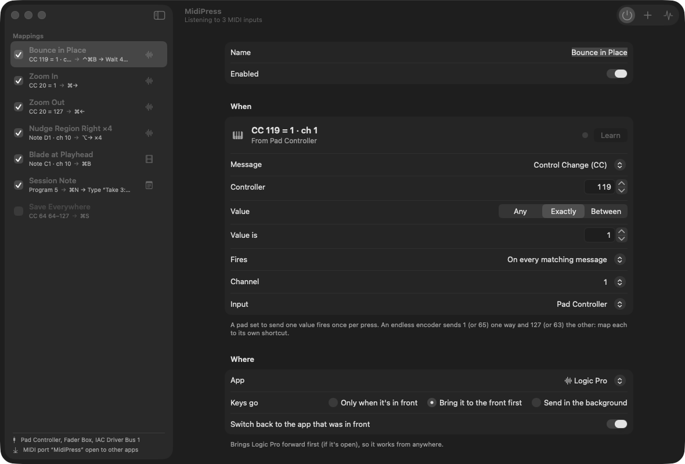
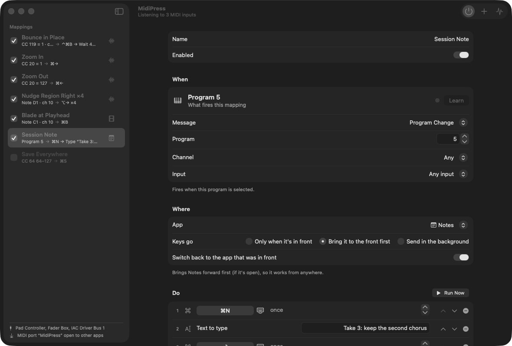
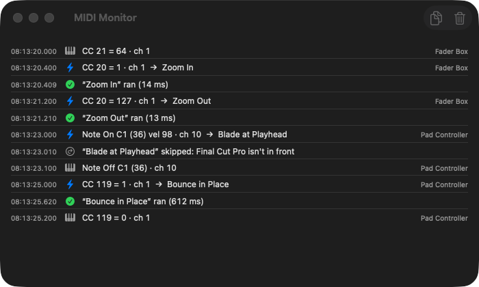

# MidiPress

A macOS app (SwiftUI, Liquid Glass) that turns MIDI messages into keyboard shortcuts and macros. Press a pad, hit a
button or turn a knob on any MIDI controller, and MidiPress presses keys for you: one shortcut, or a sequence of
shortcuts, typed text and app switches with the timing you set, in the app you choose.

Use it for anything that has a keyboard shortcut but no MIDI control: key commands in a DAW that can't be
MIDI-learned, editing in a video app, screenshots, or a whole Logic Pro routine on one pad (for example a pad that
sends value 1 of CC 119 bringing Logic forward, pressing ⌃⌘B, waiting 400 ms, pressing Return and switching back).

- **Mappings** (sidebar): each one has a trigger (When), a target app (Where) and steps (Do). The checkbox turns a
  mapping on or off; the dot lights up when it fires. Drag to reorder; right-click to run, learn, duplicate, export or
  delete.
- **When**: **Learn** (⌘L) takes the next MIDI message: its kind, number, channel and the input it came from, and
  for a controller its exact value (a pad sends one value per press). So two controllers sending the same CC can
  each fire their own mapping; set **Input** to **Any input** to accept it from all of them. The input appears under
  the trigger. Or set it by hand: Control Change, Note On, Note Off, Program
  Change or Pitch Bend; a number; any value, an exact value or a range; a channel; one input or all of them. A
  controller with a range can fire on every matching message or only when the value enters the range (a fader
  crossing a point fires once). An endless encoder sends one value per direction: map each to its own shortcut.
- **Where**: whichever app is in front, or one app:
  **Only when it's in front** (otherwise the mapping does nothing, so the same pad can do different jobs in
  different apps), **Bring it to the front first** (optionally switching back afterwards), or **Send in the
  background** (keys go straight to the app; many apps ignore keys sent this way).
- **Do**: steps run in order. **Shortcut** (click the field and press the keys, or pick a key and modifiers from
  the menu beside it; press it up to 99 times), **Wait** (milliseconds), **Text** (typed character by character,
  whatever the keyboard layout), **Switch to App** (opens it if needed). **Pause between steps** goes after each step
  and between repeats; a Wait step sets that gap itself. **Run Now** (⌘R) tries a mapping; when its keys go to the
  app in front you get three seconds to switch to it.
- **Mappings › Stop Running Mappings** (⌘., also in the menu bar) stops the running mapping at its next step and
  drops the waiting ones. Mappings run one at a time, in the order they fired; more than 64 waiting are dropped.
- **Mappings Active** (toolbar power button, ⇧⌘A, menu bar) pauses or resumes everything. MidiPress keeps working
  from the menu bar when its window is closed.
- **MIDI Monitor** (⌥⌘M): every incoming message, the mappings it fired and how each run went (ran, skipped and
  why, failed). **Copy** puts it on the clipboard.
- **Settings** (⌘,): open at login, Dock icon, how long each key is held (default 12 ms), which MIDI inputs to
  listen to, the "MidiPress" MIDI port, and the Accessibility permission.
- **File › Import / Export**: mappings as JSON, to back up or share. Imported mappings are added to the list.

<picture>
  <source media="(prefers-color-scheme: light)" srcset="docs/screenshots/mapping-light.png">
  
</picture>

<picture>
  <source media="(prefers-color-scheme: light)" srcset="docs/screenshots/macro-light.png">
  
</picture>
<picture>
  <source media="(prefers-color-scheme: light)" srcset="docs/screenshots/monitor-light.png">
  
</picture>

*Screenshots show a made-up setup; GitHub shows the light or dark set to match your theme.*

MidiPress is open source under the GNU General Public License, version 3 or later (`LICENSE`). Copyright (C) 2026
omso.

## Download

Download the newest preview from the [Releases page](https://github.com/kitedrake/midi-press/releases): the
`MidiPress-<version>.zip` file under **Assets**. It needs macOS 26 or later on a Mac with Apple silicon.

**Preview build.** MidiPress isn't signed or notarized by Apple yet, so macOS warns about it the first time you open
it. To open it anyway:

1. Unzip the download and move MidiPress to your Applications folder.
2. Open MidiPress. When macOS says it can't verify the app, click **Done**.
3. Open **System Settings › Privacy & Security**, scroll down to **Security** and click **Open Anyway** next to the
   message about MidiPress. The button shows for about an hour after you tried to open the app.
4. Confirm with **Open Anyway** and your password or Touch ID when macOS asks. From then on, MidiPress opens normally.

On current macOS, right-clicking the app and choosing **Open** no longer skips this warning. If you prefer Terminal:
`xattr -dr com.apple.quarantine /Applications/MidiPress.app`

To press keys for you, MidiPress also needs Accessibility access: it shows a banner with **Allow…** until you
grant it (see [Permission: Accessibility](#permission-accessibility)).

## Permission: Accessibility

macOS only lets an app press keys for you once it is allowed under **System Settings › Privacy & Security ›
Accessibility**. Until then MidiPress shows a banner with **Allow…**, mappings still fire (the monitor shows them),
and macOS drops the keys without a word. MidiPress reads MIDI and presses keys on this Mac; it sends nothing
anywhere.

macOS ties the permission to the app's signature. A plain `./build.sh` signs ad-hoc, so **every rebuild counts as a
new app**: turn MidiPress off and on again in the Accessibility list (or remove it with − and allow it again). Build
with a stable identity to keep the permission across builds:

```sh
SIGN_IDENTITY="Apple Development: …" ./build.sh
```

While MidiPress itself is in front, mappings whose keys go to "whichever app is in front" are skipped (the monitor
says so), so a pad pressed while you edit never types into the editor or fires MidiPress's own shortcuts. Mappings
that bring their app forward, or start by switching app, still run.

## MIDI

MidiPress listens to every MIDI input macOS offers (USB, Bluetooth, network sessions, the IAC driver), except the
ones turned off in Settings, and picks up devices as they're plugged in. It also offers a virtual MIDI port named
**MidiPress**, so other apps can send to it directly: a DAW track's MIDI output, a control-surface script, a
Max patch. The port keeps its Core MIDI unique ID across launches, so apps that remember ports find it again, and
it is listed in each mapping's **Input** menu like any other input.

Messages are read with the MIDI 1.0 protocol (Core MIDI converts MIDI 2.0 sources). Notes are named with middle C
(60) as C3, as Logic Pro and Ableton Live show them. A Note On with velocity 0 counts as a Note Off.

## How keys are pressed

Each shortcut is pressed the way fingers would: modifiers go down in order (⌃⌥⇧⌘), then the key, held for the key
hold time, then everything is let go in reverse. Events carry the flags a real keyboard adds (arrows and F-keys
count as function keys, keypad keys as keypad), come from a private event source (keys held on the real keyboard
don't mix in), and are marked as MidiPress's own. Shortcuts are stored as key positions (key codes), so a recorded
shortcut presses the same key you pressed, whatever the layout; keys are labelled with the current layout's
characters. Text is typed as characters, independent of the layout; line breaks press Return and tabs Tab.

Bringing an app forward asks macOS first; if macOS declines (it can refuse requests from an app in the background),
MidiPress makes the app frontmost through Accessibility, then opens it as the Dock would, and gives it 80 ms to
focus its window before the keys arrive.

## Saved setup

Everything is saved to `~/Library/Application Support/MidiPress/setup.json` (schema 1), readable JSON:

```json
{
  "schema" : 1, "isActive" : true, "keyHoldMS" : 12, "ignoredInputs" : [ ],
  "mappings" : [ {
    "name" : "Bounce in Place", "isEnabled" : true, "stepPauseMS" : 50,
    "trigger" : { "kind" : "controlChange", "number" : 119, "channel" : 0,
                  "value" : { "mode" : "exactly", "low" : 1, "high" : 1 }, "fire" : "everyMessage" },
    "target" : { "app" : { "bundleID" : "com.apple.logic10", "name" : "Logic Pro" },
                 "mode" : "bringToFront", "returnToPrevious" : true },
    "steps" : [ { "type" : "shortcut", "shortcut" : { "key" : 11, "modifiers" : [ "control", "command" ] }, "times" : 1 },
                { "type" : "delay", "milliseconds" : 400 },
                { "type" : "shortcut", "shortcut" : { "key" : 36, "modifiers" : [ ] }, "times" : 1 } ]
  } ]
}
```

(IDs left out here.) A file from a newer MidiPress is shown as far as it can be read and never overwritten; a file
that can't be read is moved aside (`setup.unreadable-<date>.json`) and MidiPress starts empty. Exports use the same
mapping format.

## Build and run

```sh
./build.sh                       # builds build/MidiPress.app (ad-hoc signed)
open build/MidiPress.app
```

Requires macOS 26 (Liquid Glass) and Xcode 26 or newer; the scripts use Xcode's toolchain. The icon is drawn by
`icon/make_icon.swift`; `icon/make-icns.sh` rebuilds `Resources/AppIcon.icns`.

Command line (same engine, no window):

```sh
build/MidiPress.app/Contents/MacOS/MidiPress --list-inputs        # MIDI inputs and the Accessibility status
build/MidiPress.app/Contents/MacOS/MidiPress --monitor            # print incoming MIDI until Ctrl-C
build/MidiPress.app/Contents/MacOS/MidiPress --self-test [folder] # checks the build; presses no keys
```

### With omso Builder

`omso-build.json` describes the build: `build.sh`, the engine tests (`test.sh`), then `MidiPress --self-test`,
which checks decoding, matching, the macro runner (with a recording stand-in for the keyboard), saving, and a Core
MIDI round trip through a temporary virtual input and a temporary port. **Build & Install** copies
`MidiPress.app` to `/Applications/omso`. Each installed ad-hoc build needs the Accessibility permission again.

## Development

```sh
./test.sh                                     # engine tests: decoding, matching, runner, saving, Core MIDI
```

The tests never press keys or switch apps: the runner talks to a `KeyOutput`, and tests use a recording one with
made-up apps. One test opens a temporary Core MIDI source and port in the test process (no permission prompt).

```text
Sources/MidiPressCore/      engine, no UI
  Model.swift               triggers, keys, targets, steps, mappings, setup (and their file format)
  Matcher.swift             MIDI decoding (UMP and MIDI 1.0 bytes) and trigger matching
  MacroRunner.swift         runs steps one mapping at a time; the KeyOutput protocol
  SystemKeyOutput.swift     real key events (Quartz) and app activation; the Accessibility check
  MIDIInput.swift           Core MIDI inputs and the virtual port; a test sender
  KeyCatalog.swift          key codes, names from the keyboard layout, keyboard flags
  Engine.swift, Store.swift MIDI → matcher → runner; setup.json, import and export
Sources/MidiPress/          SwiftUI app: sidebar, editor, shortcut recorder, monitor, settings, command line,
                            self-test, snapshots, updates
Tests/MidiPressCoreTests/   engine tests with a recording KeyOutput
```

## Updates and releases

Release builds can update themselves with [Sparkle](https://sparkle-project.org) 2.10.1 (pinned in
`Package.swift`), like the other apps of the same label. A plain `./build.sh`, and omso Builder's builds, have no
update feed: they never check for updates and show no update menu items. A release build gets `UPDATE_FEED_URL`,
`UPDATE_PUBLIC_KEY` and `SIGN_IDENTITY` (a Developer ID, which also turns on the hardened runtime) from the
environment.

To release: bump `VERSION` and push it, then push an annotated tag whose message is the release notes, one note per
line:

```sh
git tag -a v1.2.3 -m "First note" -m "Second note" && git push origin v1.2.3
```

The Release workflow (`.github/workflows/release.yml`) runs `scripts/release-ci.sh` on a GitHub Mac: it builds with
the update feed, runs the tests and the self-test, signs and notarizes the app when the Apple secrets are set, signs
the update when `SPARKLE_PRIVATE_KEY` is set, and publishes a GitHub release with the zip and `update.json` (a
pre-release until it's notarized). kitedrake.com then lists it for download and, once it's signed and notarized, in
the update feed. A push to `main` that changes the workflow or the script does a dry run without publishing.
`scripts/release-ci.sh` is the same file in every Kitedrake app repository: change all copies together.
`sh scripts/test-update.sh midipress` in the site repository tests a real update end to end with a throwaway key.

## Known limits

- Not yet tried with real hardware end to end: the engine, the Core MIDI path and the key sequences are tested, but
  keys reaching real apps (Logic Pro and others), shortcut recording in the window, and app switching from the
  background need a first run with a controller and the Accessibility permission.
- Keys sent in the background (to an app that isn't in front) are ignored by many apps.
- A mapping fires on one message; holding a key down for as long as a pad is held, chords of several controls, and
  menu items without a shortcut aren't supported yet.
- Shortcuts that macOS keeps for itself (⌘Tab, Spotlight, Mission Control) can't be recorded by pressing them; pick
  them from the key menu instead. Whether macOS lets a synthetic press trigger them is up to macOS.
- System keys such as volume, brightness and media keys aren't offered.
